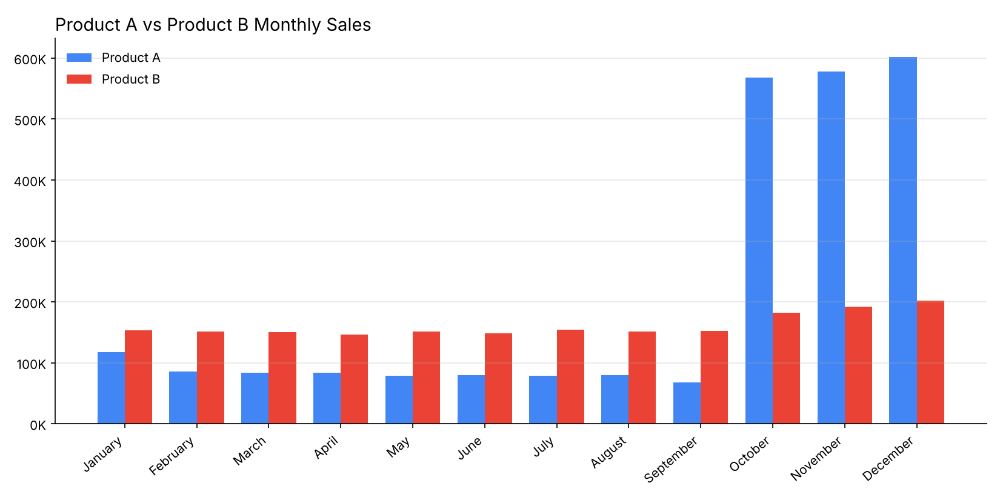

# Sales Data Visualization

Monthly sales comparison of two products (Product A and Product B) across a calendar year, built in Google Sheets.

## Data

`sales_data.csv` holds monthly sales figures for each product, plus a yearly total.

| Product   | Annual Total |
|-----------|-------------:|
| Product A | 2,502,810    |
| Product B | 1,935,236    |

## Key Findings

- **Product B is steady:** sales stay between ~147K and ~154K from January through September, then climb to ~202K by December.
- **Product A is seasonal:** it trails Product B for the first nine months (~68K–118K), then jumps roughly 8x in October and peaks at ~602K in December.
- **Q4 drives the year for Product A:** October–December account for about 70% of its annual sales, which is how it finishes the year ~29% ahead of Product B overall.

## Tools

Google Sheets (data entry, totals, and charting).
